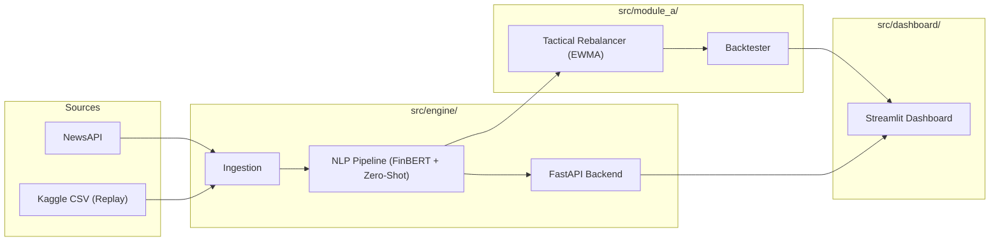

# SentinelRisk - S&P Global & Crisil Campus Hackathon

**Candidate Name:** Pradeep Modak
**College Email ID:** 2023ugcm026@nitjsr.ac.in
**College / Campus:** NIT Jamshedpur
**Demo Video Link:** https://www.youtube.com/watch?v=x6yfCl2wN3Y
**Slide Deck Link (if hosted externally):** N/A (Included in docs/)

## 1. Project Overview / Problem Statement & Approach
Financial markets react in seconds to unstructured text, such as breaking news headlines and viral social media posts. Static stock indices and manual portfolio rebalancing cannot keep up with this velocity, often leaving portfolios exposed to sudden sentiment-driven drawdowns. 

SentinelRisk solves this by serving as a unified, real-time AI/NLP risk engine. It ingests unstructured text, extracts relevant entities, and uses a finance-tuned Large Language Model (FinBERT) alongside a zero-shot event classifier to instantly quantify the market impact of the news. This intelligence is then fed directly into **Module A**, a tactical stock index rebalancer that uses an exponentially weighted moving average (EWMA) of sentiment to dynamically tilt portfolio weights within strict risk boundaries, protecting capital during bad news and capturing upside during positive events.

## 2. Architecture & Tech Stack
**Tech Stack:**
- **Backend & APIs:** Python 3.12, FastAPI, Uvicorn
- **AI/NLP:** HuggingFace Transformers, ProsusAI/finbert (Sentiment), DeBERTa-v3 (Zero-shot Event Classification)
- **Data & Quant:** Pandas, NumPy, yfinance (Prices)
- **Frontend/Dashboard:** Streamlit, Plotly

**Architecture Flow:**
1. **Sources:** NewsAPI & Kaggle Stock Tweets (Replay Mode)
2. **Ingestion:** Normalized into a common `SignalRecord` schema.
3. **NLP Pipeline:** Entity Extraction (Regex/Aliases) → FinBERT Sentiment → Event Classifier.
4. **Scoring:** Impact Scorer outputs a 1-10 severity score to a JSONL sink and via FastAPI.
5. **Module A:** The Rebalancer reads signals, computes an EWMA of sentiment, applies an exponential weight tilt, and strictly enforces 2% to 15% bounds via an iterative water-filling algorithm.
6. **Dashboard:** A 4-tab Streamlit app visualizes the live signal feed, weight changes, and backtest results.

*(Note: See `docs/architecture.png` for a visual diagram of this flow, or view the Mermaid diagram below if supported by your Markdown viewer)*



## 3. Dataset Used
- **Social Media:** A Kaggle Stock Tweets dataset was used to simulate a live social media feed.
- **News:** Synthetic news headlines generated to cover all 15 S&P 100 tickers across 6 macroeconomic and geopolitical event types.
- **Prices:** Historical daily closing prices for 15 S&P 100 tickers fetched via `yfinance` for the backtest window (2024-06-01 to 2024-08-30).
- **Assumptions:** We assume tweets and news headlines are processed instantly at the time of publication. The backtest assumes execution at the next day's close (T-1 signals applied to T returns) with a 5 basis point transaction cost.

## 4. Quickstart & Installation
Runtime: Python 3.12 on Windows / Linux / macOS

Step-by-step commands to set up the environment and run the code locally:

```bash
# 1. Clone the repository
git clone <your-repo-url>
cd <repo-folder>

# 2. Install dependencies
pip install -r requirements.txt

# 3. Setup environment variables (Enables offline DEMO_MODE)
cp .env.example .env

# 4. Warm the cache (downloads AI models and price data for offline use)
python src/scripts/warm_cache.py

# 5. Run the End-to-End Pipeline & Backtest
python src/scripts/run_backtest.py

# 6. Launch the Interactive Dashboard
streamlit run src/dashboard/app.py
```

## 5. Key Results & Domain Impact
**Results:**
During the 60-trading-day backtest, the dynamic sentiment-tilted index generated a **7.69% total return** compared to the baseline equal-weight return of 6.50%. The strategy successfully improved the Sharpe Ratio to **2.16** and reduced the maximum drawdown to **-8.69%**, all while maintaining an incredibly low average turnover of 1.37%.

**Domain Impact:**
By automating the unstructured data analysis pipeline, SentinelRisk allows portfolio managers and quantitative trading desks to systematically capture alpha from news sentiment. It removes human latency and emotional bias from tactical asset allocation. The strict water-filling constraints ensure the strategy remains compliant with institutional diversification mandates (e.g., UCITS 5/10/40 rules), making it highly viable for real-world deployment.
